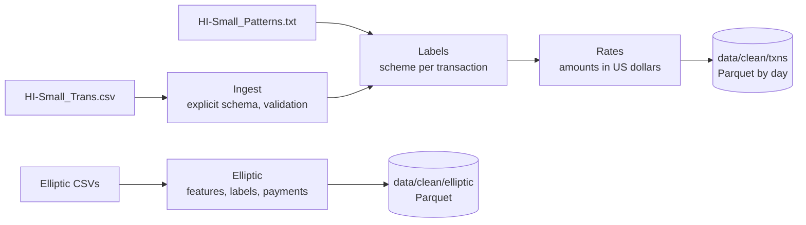

# AML Scheme Detection

Finding money-laundering schemes in bank and Bitcoin transactions, with Scala and Apache Spark.

Money launderers move dirty money through chains of accounts until it looks clean, and they tend to follow recognizable shapes: one account spreading money to many (**fan-out**), many accounts paying one (**fan-in**), money going around a loop back to where it started (**cycle**), and five more. This project builds a system that finds those shapes in millions of transactions: a Spark pipeline that describes each account's behavior and its place in the payment network, a two-stage model that flags laundering and names its scheme with a reason for every alert, and a live monitor that raises alerts on a stream of transactions.

**Status:** milestone 1 of 6 is complete. Both datasets are loaded, validated against their published numbers, labelled, and converted to US dollars. Next: account and graph features.

## Data

| Dataset | What it is | Size | Labels |
|---|---|---|---|
| [IBM HI-Small](https://www.kaggle.com/datasets/ealtman2019/ibm-transactions-for-anti-money-laundering-aml) | Simulated bank transactions in 15 currencies, September 2022 | 5,078,345 transactions | 5,177 laundering (0.1%), 3,209 of them with their scheme |
| [Elliptic](https://www.kaggle.com/datasets/ellipticco/elliptic-data-set) | Real Bitcoin transactions with anonymized features | 203,769 transactions, 234,355 payments, 49 time steps | 4,545 illicit, 42,019 licit, 157,205 unknown |

The simulated data is the main one, because real bank data is private and almost never says which scheme a laundering transaction belongs to. Elliptic checks whether the methods also work on real transactions.

## The pipeline so far

## Findings so far

1. **The last days of the simulation are mostly laundering.** Sep 11–18 hold only 1,108 transactions, but 59% of them are laundering, against 0.1% overall: they're the late steps of schemes that run past the main 10 days. A model that could see the date would learn "late means laundering", so the models leave date features out, and results are reported with and without those days.
2. **The simulator uses its own fixed exchange rates, from 2020.** Every euro-to-dollar payment uses 1 EUR = 1.1718 USD, while the real rate in September 2022 was about 1.00. The rates (euro 1.17, yen 105.4, rupee 73.4, Bitcoin about $11,900) match real ones from around August–September 2020. So the pipeline reads the rates from the data's own 72,170 cross-currency transactions, rather than downloading real ones.
3. **Laundering payments are bigger.** The median laundering payment is $5,879, against $891 for normal ones.
4. **Weekends are quieter**, with less than half a weekday's transactions.
5. **Illicit Bitcoin activity nearly disappears from Elliptic's time step 43**, which the Elliptic paper attributes to a dark market shutting down. Results on the last time steps need that context.

## How the data is checked

| Check | Result |
|---|---|
| HI-Small rows read and rejected | 5,078,345 read, 0 rejected |
| Laundering transactions | 5,177, as published |
| Scheme labels | For all 8 schemes, the transactions matched = the transactions listed; none listed are missing or flagged as normal |
| Exchange rates | Every currency has one; for almost every pair, 90% of rates lie within 0.1% of each other |
| US-dollar amounts | Every row has one; paid and received never differ by more than 1% and more than $1 |
| Elliptic | 203,769 transactions, labels and 234,355 payments, as published; no payment crosses time steps |

Every function also has tests on small hand-made examples, and CI runs all of them on every pull request.

## Project layout

| Module | What's in it | Main libraries |
|---|---|---|
| `common` | Code shared by the other two: later, the rules language and model weights | Scala parser combinators |
| `batch` | Loading data, features and models | Apache Spark 4 |
| `monitor` | The live monitor | Akka typed actors and Streams |

Spark and Akka sit in separate modules because their dependencies clash. See [docs/decisions.md](docs/decisions.md) for this and the other design decisions, and [docs/data.md](docs/data.md) for every column of the cleaned data.

## Run it

You need JDK 17 and sbt, or IntelliJ IDEA with the Scala plugin, which includes sbt.

1. Clone the repo.
2. Download the data into `data/raw/` (it's not committed, because it's large):
   - From [IBM's dataset](https://www.kaggle.com/datasets/ealtman2019/ibm-transactions-for-anti-money-laundering-aml): `HI-Small_Trans.csv` and `HI-Small_Patterns.txt`, into `data/raw/`.
   - From [Elliptic](https://www.kaggle.com/datasets/ellipticco/elliptic-data-set): its three CSV files, into `data/raw/elliptic/`.
3. Run the tests: `sbt test`
4. Load and check the data:
   - `sbt "batch/runMain aml.batch.IngestMain"` (about 20 seconds on a laptop)
   - `sbt "batch/runMain aml.batch.EllipticMain"` (about 10 seconds)

The cleaned data goes to `data/clean/`.

## Roadmap

| Milestone | Parts | Status |
|---|---|---|
| M1: Data ingested | Load IBM transactions and scheme labels, exchange rates and US dollars, Elliptic | ✓ Done |
| M2: Features | Each account's behavior over 24 hours; graph features: fan-out, fan-in, cycles, scatter-gather | Next |
| M3: Stage 1, rules, reason codes | Is it laundering? A rules language, and a reason for every alert | |
| M4: Stage 2 and real data | Which of the 8 schemes; the check on Elliptic | |
| M5: Live monitor | Streaming alerts with Akka | |
| M6: Write-up and demo | Results and a live demo | |

## How it's built

Every part is one issue, built on its own branch and merged through a pull request after CI passes; `main` is protected, so nothing reaches it any other way. Each pull request explains what changed, why, and what it found on the real data.

## Credits

- **IBM HI-Small:** E. Altman et al., *Realistic Synthetic Financial Transactions for Anti-Money Laundering Models*, NeurIPS 2023 Datasets and Benchmarks.
- **Elliptic:** M. Weber et al., *Anti-Money Laundering in Bitcoin: Experimenting with Graph Convolutional Networks for Financial Forensics*, KDD 2019 Workshop on Anomaly Detection in Finance.
- See [ATTRIBUTION.md](ATTRIBUTION.md) for libraries and other help.

## License

[MIT](LICENSE)
